👨‍💻 Sobre mim
Desenvolvedor Full Stack no CPQD, com experiência profissional em React e TypeScript (Frontend) e atuação atual com Go (Backend), APIs, mensageria e integração de serviços. Estudando aplicações de IA, RAG e agentes inteligentes.
📍 Campinas, SP · 🎓 Análise e Desenvolvimento de Sistemas — conclusão prevista para outubro/2026
💼 Experiência profissional
CPQD · ~1 ano em Frontend (React / TypeScript / CSS-in-JS) · ~10 meses em Backend (Go / APIs / Mensageria).
🛠️ Tecnologias e ferramentas
Frontend & UI

Backend, APIs & Dados

Infraestrutura, DevOps & Ferramentas

Design & Mobile

🧠 Inteligência Artificial
Estudos e projetos práticos: RAG, embeddings, busca semântica, LLMs locais, agentes de IA e automação assistida por IA.

Projeto de estudo: Second Brain local com Obsidian + Ollama + Qdrant, indexação de arquivos e respostas baseadas em contexto recuperado.
📊 GitHub Insights

Estatísticas de repositórios públicos. Não incluem necessariamente o trabalho corporativo no Bitbucket e não representam nível de domínio das linguagens.

🟩 Atividade no GitHub

